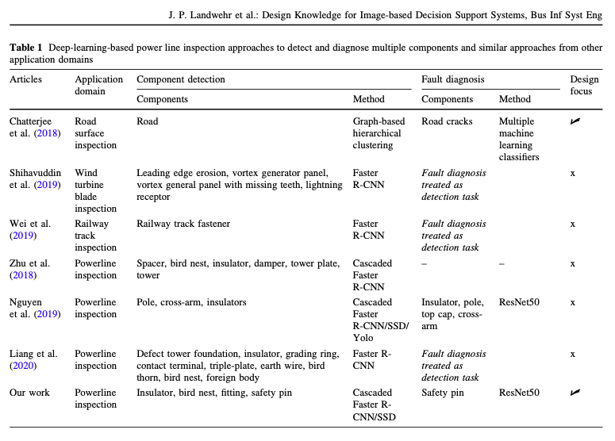

# Some rules to follow when giving a (scientific) presentation...

Welcome, welcome, welcome! You are about to present your Bachelor's thesis, Master's thesis, or PhD work (proposal, interim, final, or conference talk). This guide is the sibling of [howtopaper](https://github.com/nkukit/howtopaper) and follows the same idea: a short list of rules that save us both time. Most rules from howtopaper (one term per concept, be specific, self-contained captions, vector graphics) apply to slides as well, so read that one first.

A talk is *not* a paper read aloud. The audience cannot scroll back, re-read a sentence, or skip ahead. Everything below follows from that.

## 1. Before you open PowerPoint

- **Know your audience.** Who is in the room, what do they already know, and what do they want to get out of your talk? A thesis defense, a chair colloquium, and a conference session need three different talks on the same content.
- **Write down your take-home messages first.** At most three. If a listener remembers only these a week later, the talk was a success --> Everything that does not serve one of them goes to the backup slides.
- **Less is more.** The most common mistake is trying to say too much. You cannot present the whole thesis; you present its argument. Remember that for a PhD defense you have 30 minutes to present 4 years of work...and this still has to, well, work.
- **Tell a story.** Problem, gap, what you did, what you found, what it means. Use --> one <-- running example throughout the talk instead of switching between use cases.
- **Plan with messages, not topics.** Write the headline of every slide as a list in a text file before designing anything. If the headlines alone tell the story, the structure works.
- **Respect the time limit.** Plan roughly one content slide per minute of speaking time, and leave a buffer. Overrunning is the one mistake everybody in the room notices. I'll be tough on this in our rehearsals.

## 2. Structure

Every scientific presentation at our chair follows the same six parts. The share of time is a rule of thumb for a 20-minute talk; adapt it to your slot.

| Part | Question it answers | Share of time |
|---|---|---|
| Intro / Motivation | Why should anyone care? What is the problem and your research question? | ~15% |
| Related Work | What has been done, and what is missing? | ~10% |
| Methodology | What did you do, and why this way? | ~20% |
| Results | What did you find? | ~30% |
| Discussion | What does it mean, and where are the limits? | ~15% |
| Conclusion | What should the audience remember? | ~10% |

### Title slide

- Full title, your name, type of talk (e.g., "Master thesis final presentation"), supervisor(s), institution, and date.
- No "agenda" slide for short talks. If the talk is longer than 20 minutes, one outline slide is fine, and you may show progress through the six parts.

### Intro / Motivation

- Start with the problem, not with yourself or the outline. A concrete example, a number, or a short case works better than a definition.
- I personally like news articles or a large picture with a situation or problem that is common and everyone can relate to
- Lead from the real-world problem to the research gap to your **research question(s)** (RQs). State them explicitly on a slide.
- State your contribution early. The audience should know after the introduction what you will show them. This is no crime novel 🙃
- Define the few terms you need, once, and stick to them.

### Related Work

- **Always use a table.** Do not present a list of papers with one bullet each. See [Section 4](#4-the-related-work-table) for the required format.
- Group the literature by streams or concepts, not paper by paper.
- End this part with the gap: one sentence saying what none of the existing work does, and that this is what you do. This should then also directly relate to your RQ(s).

### Methodology

- Show the research design as **one overview figure** (process, pipeline, study design) and come back to it when you move from one step to the next.
- Justify the main design decisions: why this method, this data set, this sample, this evaluation.
- Give the numbers the audience needs to judge the results: sample size, data source, conditions, metrics, baselines.
- Details (hyperparameters, full questionnaires, interview guides) belong in the backup slides.

### Results

- One result per slide. The headline states the finding, the body shows the evidence.
- Prefer figures over tables, and tables over text. If you show a table, highlight the cells you talk about.
- Walk the audience through every figure: say what the axes are, then what to look at, then what it means.
- Report results honestly, including the ones that did not work. Do not hide them in small print.

### Discussion

- Interpret the results: answer the research questions from the introduction explicitly.
- Relate your findings to the related work table: where do you confirm, extend, or contradict prior work?
- Name implications for theory and for practice.
- **Limitations are mandatory.** Naming them yourself is stronger than being asked about them.

### Conclusion

- Repeat the take-home messages (at most three) and the contribution.
- Give a short outlook on future work.
- Return to your opening idea / challenge / case to tell an end-to-end story.
- **The last slide is the conclusion slide**, and it stays up during the Q&A. Do not end on a slide just showing "Thank you!" or "Questions?". A slide with your key messages and contact details is far more useful for the discussion.

### After the last slide

- **References:** list the full references of everything you cite on the slides. You do not present this slide.
- **Backup slides:** prepare slides for the questions you expect (additional analyses, robustness checks, details on data and method). Number them separately (e.g., "B1, B2").

## 3. Slide design basics

### On every slide (except the title slide)

- **Running title** (a short version of your talk title), **your name**, and the **date** in the footer.
- **Slide number**, ideally as "current / total" (e.g., "7 / 18"). People refer to slide numbers when asking questions, and the total tells them where you are. Backup slides do not count toward the total.
- Set these once in the slide master, not by hand on every slide.

### Text

- **Font size: nothing below 12 pt, anywhere on the slide.** That is the hard lower limit, and it also applies to axis labels, legends, table cells, footnotes, and sources. Body text should be considerably larger: aim for 18 pt or more, and 24 pt or more for headlines. If the text does not fit, you have too much text, not too large a font.
- Use one sans-serif font throughout (the chair or university template gives you one).
- **One idea per slide.** If you need "and" in the headline, make two slides.
- **Headlines are messages, not topics.** Write "Explanations increase reliance on wrong AI advice" instead of "Results (2)". A full-sentence headline plus visual evidence in the body is called the assertion-evidence structure, and it works. The six parts from Section 2 give the talk its order; you can show the current part as a small section label.
- Keep headlines to two lines at most.
- No full sentences in the body and no paragraphs. The audience either reads or listens, not both.
- Do not use the slides as your speaker notes. Use the notes field for that.

### Figures and tables

- Redraw figures for slides. A figure from the paper is usually too small and too detailed.
- Label axes, include units, and label lines directly instead of using a far-away legend where possible.
- Export figures as vector graphics (PDF/SVG), as in howtopaper.
- Highlight what matters: color for the one series, bar, or cell you talk about, gray for the rest.
- Never show a table or figure that you do not explain.

### Color, contrast, and layout

- Dark text on a light background, with high contrast. Projectors wash colors out.
- Use color with a purpose and consistently: the same color means the same thing on every slide.
- Do not rely on color alone, and avoid red/green contrasts. Check your figures with a color-blindness simulator such as [Color Oracle](https://colororacle.org/).
- Leave white space. Align elements. Use the template, and do not fight it.
- 16:9 format, unless the room demands otherwise.

### Animations and extras

- Use animations to build up a complex figure step by step.
- Avoid embedded videos and live demos unless they are essential, and have a screenshot as a fallback.
- **Cite on the slide:** every figure, number, or claim that is not yours gets a short reference ("Author et al. (Year)") on the same slide, and the full reference at the end.

## 4. The related work table

Related work is always presented as a table (a concept matrix in the sense of Webster and Watson 2002). The table makes the research gap visible at a glance.

Rules:

- **Rows are articles** (or groups of articles), sorted by year or by stream.
- **Columns are the dimensions that matter for your contribution**: application domain, task, method, data, evaluation, and so on. Choose them so that they describe your own work as well.
- **The last column shows the focus you claim as your gap**, marked with ✓ or ✗.
- **The last row is "Our work"**, visually highlighted (bold). It should be the only row, or one of very few, with a ✓ in the gap column or with the full combination of characteristics.
- Keep it to roughly five to eight rows on a slide. The complete table belongs in the thesis or paper and in the backup slides.
- Keep cell entries short (keywords, not sentences), and mind the 12 pt limit.
- Be fair. Do not define the columns so narrowly that the gap is artificial, and expect the question "what about paper X?".

Example:

  

For a real example of this format, see Table 1 in Landwehr et al., "Design Knowledge for Image-based Decision Support Systems", Business & Information Systems Engineering.

## 5. Delivery

- **Rehearse out loud, with a timer, several times.** At least once in front of somebody who is not afraid to criticize you. Reading the slides silently is not rehearsing.

    
  </a> 

- Know your first two minutes and your last minute by heart. Everything in between can be free speech.
- NEVER read verbatim from your notes. NEVER let AI tools generate every sentence and just read it out loud. Everyone will notice.
- Talk to the audience (!), not to the screen or the laptop.
- Do not read from the slides.
- Speak slowly, and pause after important statements. A pause feels much longer to you than to the audience.
- If you run out of time, skip slides and go to the conclusion. Do not speed up.
- Record yourself once. It is unpleasant and very effective.

## 6. Q&A

- Listen to the whole question, and repeat or rephrase it briefly, in particular in hybrid settings.
- Answer short and to the point. Jump to the matching backup slide if you have one.
- "I do not know" or "we did not test that" is a perfectly good answer. Making something up is not.
- A critical question is interest in your work, not an attack.

## 7. Technical checklist

- Send the slides to your supervisor in advance, as agreed (usually a few days before the talk).
- Bring the slides as PDF in addition to the original file, and have a copy in the cloud or on a USB stick.
- Check the room, the projector, the adapter, and the clicker beforehand. For online talks, test screen sharing and audio.
- Embed fonts or export as PDF if you present from another computer.
- Switch off notifications.
- File name: `YYYY-MM-DD_Lastname_ShortTitle.pdf`.

## 8. Final check before you send the slides

- [ ] The six parts are there, in this order: Intro/Motivation, Related Work, Methodology, Results, Discussion, Conclusion
- [ ] Research question(s) are stated explicitly on a slide
- [ ] Related work is a table with "Our work" as the last row
- [ ] Limitations are named
- [ ] The last slide is a conclusion slide with the take-home messages
- [ ] Running title, name, date, and slide number are on every slide
- [ ] No text below 12 pt, including figures and tables
- [ ] Every headline is a message
- [ ] One idea per slide
- [ ] All figures have labeled axes and are readable from the back row
- [ ] All external content is cited on the slide, with full references at the end
- [ ] Backup slides exist for the obvious questions
- [ ] The talk was rehearsed with a timer and fits the slot

## Further reading

- Bourne (2007). [Ten Simple Rules for Making Good Oral Presentations](https://doi.org/10.1371/journal.pcbi.0030077). PLOS Computational Biology.
- Naegle (2021). [Ten simple rules for effective presentation slides](https://doi.org/10.1371/journal.pcbi.1009554). PLOS Computational Biology.
- Lortie (2017). [Ten simple rules for short and swift presentations](https://doi.org/10.1371/journal.pcbi.1005373). PLOS Computational Biology.
- Alley (2013). The Craft of Scientific Presentations. Springer. See also [assertion-evidence.com](https://www.assertion-evidence.com/) for templates and examples.
- Webster and Watson (2002). Analyzing the Past to Prepare for the Future: Writing a Literature Review. MIS Quarterly.
- [Slide Accessibility Guidance](https://www.cctl.cam.ac.uk/slide-accessibility-guidance), University of Cambridge.
